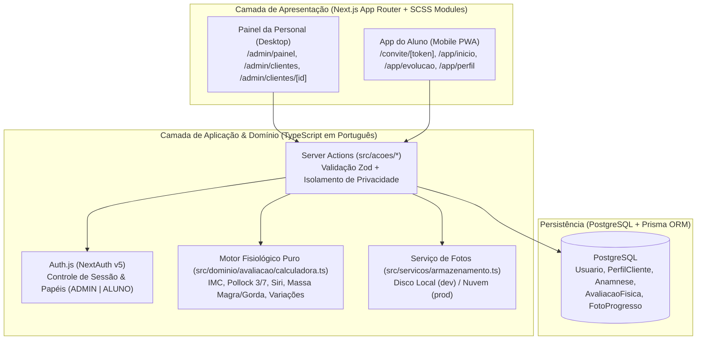

# Especificação de Design — Sub-projeto 1: Fundação, Design System SCSS & Gestão de Clientes, Anamnese e Avaliações Físicas

- **Data:** 2026-10-17
- **Projeto:** PersonalTrainer (*Joana Antunes Coaching*)
- **Escopo:** Sub-projeto 1 de 4 do MVP (Fundação + Gestão de Clientes, Convites, Anamnese/PAR-Q, Avaliação Física Pollock 3/7 & Fotos de Evolução)

---

## 1. Visão Geral e Objetivos

O produto é uma plataforma B2B2C no formato **Aplicação Web Responsiva + PWA** voltada para Personal Trainers gerenciarem seus alunos com alto padrão visual (*Joana Antunes Coaching*).

Todo o projeto segue a diretriz de **Nomenclatura 100% em Português** (definida no `AGENTS.md`): pastas de código, arquivos de componentes, funções de domínio, tabelas e colunas do banco de dados e variáveis SCSS utilizam termos claros em português.

O MVP está organizado em 4 sub-projetos sequenciais:
1. **Sub-projeto 1 (Este documento):** Fundação (Autenticação, Layouts Admin/Aluno, Design System em SCSS) + Gestão de Clientes, Convite por Link Único, Anamnese Clínica (PAR-Q) e Avaliações Físicas (Perimetria, Pollock 3/7 Dobras e Fotos Antes/Depois).
2. **Sub-projeto 2:** Biblioteca de Exercícios & Prescrição de Planos de Treino.
3. **Sub-projeto 3:** Execução de Treino pelo Aluno (Mobile PWA — Registro de Cargas, Séries e Cronômetro).
4. **Sub-projeto 4:** Check-in Semanal, Agenda & Acompanhamento.

---

## 2. Stack Tecnológica & Arquitetura



- **Framework:** Next.js (App Router) com TypeScript estrito.
- **Estilização:** **SCSS Puro + CSS Modules (`.module.scss`)**. Zero Tailwind CSS.
- **Banco de Dados:** PostgreSQL com Prisma ORM (`prisma/schema.prisma`).
- **Autenticação:** Auth.js com validação de credenciais (`bcryptjs`) e controle de papéis (`ADMIN` | `ALUNO`).
- **Validação:** `zod` em todas as entradas de dados (`src/dominio/validadores/`).
- **Testes:** `vitest` + `@testing-library/react` em `testes/`.

---

## 3. Design System & Arquitetura SCSS (`src/estilos/`)

Seguindo as regras definidas em `AGENTS.md`:

### 3.1 Estrutura de Arquivos SCSS
- `src/estilos/_variaveis.scss`:
  - Cores escuras: `$cor-fundo-escuro: #141414`, `$cor-superficie-escura: #1E1E1E`
  - Cores claras: `$cor-fundo-claro: #F8F7F4`, `$cor-fundo-cartao: #FFFFFF`
  - Cores douradas: `$cor-dourado-primario: #C5A059`, `$cor-dourado-hover: #B38E46`, `$cor-dourado-suave: #F3ECE0`, `$cor-borda-dourada: #E2D1B3`
  - Cores de texto e borda: `$cor-texto-primario: #1A1A1A`, `$cor-texto-secundario: #757575`, `$cor-borda: #EAE6DF`
  - Cores semânticas: `$cor-sucesso: #2E7D32`, `$cor-alerta: #F57C00`, `$cor-perigo: #C62828`
- `src/estilos/_mixins.scss`:
  - `@mixin superficie-cartao`, `@mixin botao-dourado`, `@mixin botao-contorno`, `@mixin campo-entrada` (forçando `color: $cor-texto-primario` e `background-color: #FFFFFF`), `@mixin tela-desktop`, `@mixin tela-mobile`.
- `src/estilos/globais.scss`: Reset CSS e padronização tipográfica.

---

## 4. Modelo de Dados em Português (`prisma/schema.prisma`)

```prisma
enum PapelUsuario {
  ADMIN
  ALUNO
}

enum StatusCliente {
  CONVIDADO
  ATIVO
  INATIVO
}

enum SexoBiologico {
  MASCULINO
  FEMININO
}

enum NivelAtividade {
  SEDENTARIO
  LEVE
  MODERADO
  INTENSO
}

enum ProtocoloAvaliacao {
  POLLOCK_7
  POLLOCK_3
  BIOIMPEDANCIA
  MANUAL
}

enum AnguloFoto {
  FRENTE
  COSTAS
  PERFIL
}

model Usuario {
  id                String          @id @default(cuid())
  nome              String
  email             String          @unique
  senhaHash         String
  papel             PapelUsuario    @default(ALUNO)
  criadoEm          DateTime        @default(now())
  atualizadoEm      DateTime        @updatedAt

  // Relacionamentos
  clientesGeridos   PerfilCliente[] @relation("ClientesDoTreinador")
  perfilAluno       PerfilCliente?  @relation("UsuarioDoAluno")
}

model PerfilCliente {
  id                  String             @id @default(cuid())
  treinadorId         String
  treinador           Usuario            @relation("ClientesDoTreinador", fields: [treinadorId], references: [id], onDelete: Cascade)
  usuarioId           String?            @unique
  usuario             Usuario?           @relation("UsuarioDoAluno", fields: [usuarioId], references: [id], onDelete: SetNull)

  nomeCompleto        String
  email               String
  telefone            String?
  dataNascimento      DateTime?
  sexo                SexoBiologico      @default(FEMININO)
  alturaCm            Float?
  objetivoPrincipal   String?
  status              StatusCliente      @default(CONVIDADO)

  tokenConvite        String?            @unique
  conviteExpiraEm     DateTime?

  criadoEm            DateTime           @default(now())
  atualizadoEm        DateTime           @updatedAt

  anamnese            Anamnese?
  avaliacoes          AvaliacaoFisica[]
  fotosProgresso      FotoProgresso[]

  @@index([treinadorId])
  @@unique([treinadorId, email])
}

model Anamnese {
  id                        String         @id @default(cuid())
  clienteId                 String         @unique
  cliente                   PerfilCliente  @relation(fields: [clienteId], references: [id], onDelete: Cascade)

  // Questionário PAR-Q (7 perguntas oficiais)
  parqProblemaCardiaco      Boolean        @default(false)
  parqDorPeitoAtividade     Boolean        @default(false)
  parqDorPeitoRepouso       Boolean        @default(false)
  parqTonturaDesmaio        Boolean        @default(false)
  parqProblemaOsseoArticular Boolean       @default(false)
  parqMedicamentoPressao    Boolean        @default(false)
  parqOutraRazaoMedica      Boolean        @default(false)
  possuiRestricaoMedica     Boolean        @default(false)

  // Histórico Clínico & Rotina
  lesoesOuDores             String?
  historicoCirurgias        String?
  medicamentos              String?
  alergias                  String?
  mediaHorasSono            Float?
  qualidadeSono             String?
  nivelAtividadeTrabalho    NivelAtividade @default(SEDENTARIO)
  ingestaoAguaLitros        Float?
  observacoes               String?

  preenchidaEm              DateTime       @default(now())
  atualizadoEm              DateTime       @updatedAt
}

model AvaliacaoFisica {
  id                       String             @id @default(cuid())
  clienteId                String
  cliente                  PerfilCliente      @relation(fields: [clienteId], references: [id], onDelete: Cascade)
  avaliadoEm               DateTime           @default(now())

  pesoKg                   Float
  alturaCm                 Float
  imc                      Float

  protocolo                ProtocoloAvaliacao @default(POLLOCK_7)
  // Dobras Cutâneas (mm)
  dobraPeitoralMm          Float?
  dobraAxilarMediaMm       Float?
  dobraTricepsMm           Float?
  dobraSubescapularMm      Float?
  dobraAbdominalMm         Float?
  dobraSuprailiacaMm       Float?
  dobraCoxaMm              Float?

  // Resultados Calculados de Composição Corporal
  somaDobrasMm             Float?
  densidadeCorporal        Float?
  percentualGordura        Float?
  massaGordaKg             Float?
  massaMagraKg             Float?

  // Perimetria / Circunferências (cm)
  pescocoCm                Float?
  ombrosCm                 Float?
  toraxCm                  Float?
  cinturaCm                Float?
  abdomenCm                Float?
  quadrilCm                Float?
  bracoRelaxadoDireitoCm   Float?
  bracoRelaxadoEsquerdoCm  Float?
  bracoContraidoDireitoCm  Float?
  bracoContraidoEsquerdoCm Float?
  antebracoDireitoCm       Float?
  antebracoEsquerdoCm      Float?
  coxaDireitaCm            Float?
  coxaEsquerdaCm           Float?
  panturrilhaDireitaCm     Float?
  panturrilhaEsquerdaCm    Float?

  observacoes              String?
  fotos                    FotoProgresso[]

  @@index([clienteId, avaliadoEm])
}

model FotoProgresso {
  id          String           @id @default(cuid())
  clienteId   String
  cliente     PerfilCliente    @relation(fields: [clienteId], references: [id], onDelete: Cascade)
  avaliacaoId String?
  avaliacao   AvaliacaoFisica? @relation(fields: [avaliacaoId], references: [id], onDelete: SetNull)

  angulo      AnguloFoto
  urlImagem   String
  registradaEm DateTime        @default(now())

  @@index([clienteId, registradaEm])
}
```

---

## 5. Motor de Cálculos Fisiológicos (`src/dominio/avaliacao/calculadora.ts`)

Módulo puro com todas as funções e parâmetros em português:

1. **`calcularImc(pesoKg, alturaCm)`:**
   - Retorna o IMC arredondado em 2 casas decimais: $\frac{\text{pesoKg}}{(\text{alturaCm} / 100)^2}$.
2. **`calcularPollock7Dobras(dados)`:**
   - Soma $S_7 = \text{peitoral} + \text{axilarMedia} + \text{triceps} + \text{subescapular} + \text{abdominal} + \text{suprailiaca} + \text{coxa}$.
   - **Masculino:** $D = 1.112 - 0.00043499(S_7) + 0.00000055(S_7)^2 - 0.00028826(\text{idade})$.
   - **Feminino:** $D = 1.097 - 0.00046971(S_7) + 0.00000056(S_7)^2 - 0.00012828(\text{idade})$.
3. **`calcularPollock3Dobras(dados)`:**
   - **Masculino** ($\text{peitoral} + \text{abdominal} + \text{coxa}$): $D = 1.10938 - 0.0008267(S_3) + 0.0000016(S_3)^2 - 0.0002574(\text{idade})$.
   - **Feminino** ($\text{triceps} + \text{suprailiaca} + \text{coxa}$): $D = 1.0994921 - 0.0009929(S_3) + 0.0000023(S_3)^2 - 0.0001392(\text{idade})$.
4. **`calcularComposicaoCorporalSiri(pesoKg, densidadeCorporal)`:**
   - $\text{percentualGordura} = \left(\frac{495}{D}\right) - 450$.
   - $\text{massaGordaKg} = \text{pesoKg} \times (\frac{\text{percentualGordura}}{100})$.
   - $\text{massaMagraKg} = \text{pesoKg} - \text{massaGordaKg}$.
5. **`calcularVariacaoAvaliacoes(avaliacaoAtual, avaliacaoAnterior)`:**
   - Retorna `variacaoPesoKg`, `variacaoPercentualGordura` e `variacaoMassaMagraKg`.
6. **`verificarRestricaoParq(respostasParq)`:**
   - Retorna `possuiRestricaoMedica = true` se qualquer uma das 7 respostas for `true`.

---

## 6. Fluxos Funcionais e Rotas em Português

- `/entrar` — Tela de início de sessão unificada (redireciona `ADMIN` para `/admin/painel` e `ALUNO` para `/app/inicio`).
- `/convite/[token]` — Fluxo Mobile PWA do aluno convidado: boas-vindas ("Olá, Nome") -> definir senha -> formulário de Anamnese em 3 etapas + envio das 3 fotos iniciais (`FRENTE`, `COSTAS`, `PERFIL`).
- `/admin/painel` — Painel principal da Personal (Indicadores de *Clientes Ativos*, *Anamneses Pendentes*, *Avaliações Realizadas* e alertas PAR-Q).
- `/admin/clientes` — Tabela de clientes com pesquisa por nome/email, filtro por status e modal **"+ Novo Cliente"** para gerar link de convite ou preencher presencialmente.
- `/admin/clientes/[id]` — Perfil 360º do Cliente com abas:
  - `Resumo`: Dados Pessoais, Estatísticas de Evolução, Gráfico SVG Dourado de Peso, Última Avaliação, Fotos de Progresso e Perimetria Chave.
  - `Avaliações`: Calculadora interativa Pollock 7 / Pollock 3 + Perimetria e histórico comparativo.
  - `Anamnese`: Questionário clínico completo e status do PAR-Q.
  - `Progresso`: Comparador lado a lado Antes vs. Atual por ângulo (`Frente`, `Costas`, `Perfil`).
- `/app/inicio`, `/app/evolucao` e `/app/perfil` — Visão Mobile PWA do Aluno com barra de navegação inferior de 5 ícones.

---

## 7. Segurança, Upload de Fotos & Estratégia de Testes (TDD)

- **Privacidade Total:**
  - Todas as funções em `src/acoes/` extraem `treinadorId` ou `usuarioId` diretamente da sessão autenticada.
  - Rota de leitura de fotos `/api/fotos/[fotoId]` valida se o usuário logado é o `treinadorId` responsável ou o próprio `usuarioId` do aluno.
- **Testes Automatizados (`testes/`):**
  - `testes/unitario/calculadora.test.ts`: Testes de todas as fórmulas de IMC, Pollock 3 e 7, Siri, Variações e PAR-Q.
  - `testes/unitario/validadores.test.ts`: Testes de limites fisiológicos e regras de expiração de token de convite.
  - `testes/integracao/fluxo-convite-avaliacao.test.ts`: Teste completo de pré-cadastro -> ativação de convite -> anamnese -> avaliação física -> isolamento de privacidade.
