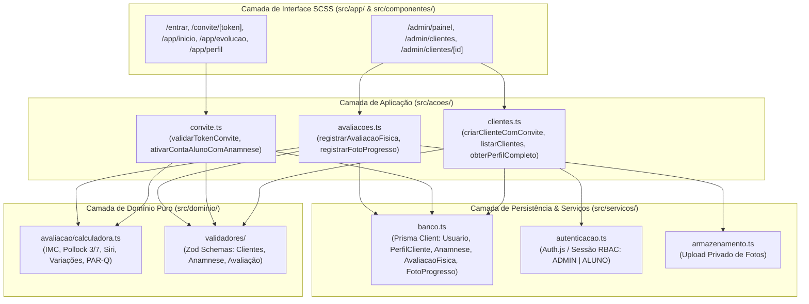

# Plano de Implementação — Sub-projeto 1: Fundação, Design System SCSS & Gestão de Clientes, Anamnese e Avaliações Físicas

> **For agentic workers:** REQUIRED SUB-SKILL: Use superpowers:subagent-driven-development to implement this plan task-by-task. Steps use checkbox (`- [ ]`) syntax for tracking.

**Goal:** Construir a fundação da plataforma PersonalTrainer (*Joana Antunes Coaching*) com Next.js App Router, Prisma/PostgreSQL, Auth.js e Design System 100% em SCSS puro, entregando o módulo completo de Gestão de Clientes, Convites por Link Único, Anamnese Clínica (PAR-Q), Avaliações Físicas (Pollock 3/7 Dobras, Siri, IMC e Perimetria) e Comparador de Fotos de Evolução.

**Architecture:** Aplicação monolítica modular em Next.js App Router (TypeScript estrito), separando a lógica pura de domínio fisiológico e validação Zod (`src/dominio/`) das Server Actions autenticadas (`src/acoes/`), persistência Prisma (`src/servicos/`) e interface de usuário dividida entre Área da Personal (`src/app/admin/`) e Área Mobile PWA do Aluno (`src/app/app/` e `src/app/convite/`).

**Architecture Diagram:**



**Tech Stack:** Next.js 15 (App Router), React 19, TypeScript 5, SCSS Modules (`sass`), Prisma ORM + PostgreSQL, Auth.js (`next-auth@beta`) + `bcryptjs`, `zod`, Vitest + Testing Library.

**Spec:** [2026-10-17-subprojeto1-fundacao-e-clientes.md](file:///c:/Projetos/PersonalTrainer/docs/especificacoes/2026-10-17-subprojeto1-fundacao-e-clientes.md)

## Global Constraints

- **Nomenclatura 100% em Português:** Pastas (`src/estilos/`, `src/dominio/`, `src/componentes/`, `src/acoes/`, `src/servicos/`, `testes/`), tabelas/colunas do Prisma (`Usuario`, `PerfilCliente`, `Anamnese`, `AvaliacaoFisica`, `FotoProgresso`), funções e variáveis SCSS devem ser em português, conforme [AGENTS.md](file:///c:/Projetos/PersonalTrainer/AGENTS.md).
- **Zero Tailwind CSS:** Proibido instalar ou usar Tailwind ou CSS-in-JS. Toda estilização deve usar `.module.scss` importando `src/estilos/_variaveis.scss` e `src/estilos/_mixins.scss`.
- **Contraste Obrigatório de Fontes:** Superfícies claras (`#FFFFFF`, `#F8F7F4`) devem ter texto explícito `#1A1A1A` (principal) e `#555555`/`#757575` (secundário), incluindo `input`, `select`, `textarea` e `table`. Texto `#FFFFFF` apenas sobre fundos escuros (`#141414`, `#1E1E1E`).
- **Privacidade Total:** Todas as Server Actions de `ADMIN` filtram por `treinadorId = sessao.usuario.id`; todas as ações de `ALUNO` filtram pelo `PerfilCliente` vinculado ao `sessao.usuario.id`.
- **TDD Estrito:** Nenhuma função de negócio ou ação deve ser implementada antes do seu respectivo teste falhar no Vitest.

---

### Task 1: Estrutura Inicial Next.js, Configuração Vitest e Design System SCSS

**Files:**
- Create: `package.json`
- Create: `tsconfig.json`
- Create: `next.config.ts`
- Create: `vitest.config.ts`
- Create: `.gitignore`
- Create: `src/estilos/_variaveis.scss`
- Create: `src/estilos/_mixins.scss`
- Create: `src/estilos/globais.scss`
- Create: `src/app/layout.tsx`
- Create: `src/app/page.tsx`
- Test: `testes/unitario/ambiente.test.ts`

**Interfaces:**
- Produces: Tokens SCSS globais (`$cor-fundo-escuro`, `$cor-fundo-claro`, `$cor-dourado-primario`, `$cor-texto-primario`, `@mixin superficie-cartao`, `@mixin botao-dourado`, `@mixin campo-entrada`) e ambiente de testes Vitest configurado com alias `@/* -> ./src/*`.

- [ ] **Step 1: Criar `package.json`, `tsconfig.json`, `next.config.ts`, `vitest.config.ts` e `.gitignore`**

Criar `package.json`:
```json
{
  "name": "personal-trainer-joana-antunes",
  "version": "0.1.0",
  "private": true,
  "scripts": {
    "dev": "next dev",
    "build": "next build",
    "start": "next start",
    "test": "vitest run",
    "test:watch": "vitest"
  },
  "dependencies": {
    "bcryptjs": "^2.4.3",
    "next": "^15.1.0",
    "react": "^19.0.0",
    "react-dom": "^19.0.0",
    "zod": "^3.24.1",
    "@prisma/client": "^6.2.1"
  },
  "devDependencies": {
    "@testing-library/jest-dom": "^6.6.3",
    "@testing-library/react": "^16.1.0",
    "@types/bcryptjs": "^2.4.6",
    "@types/node": "^22.10.2",
    "@types/react": "^19.0.2",
    "@types/react-dom": "^19.0.2",
    "@vitejs/plugin-react": "^4.3.4",
    "jsdom": "^25.0.1",
    "prisma": "^6.2.1",
    "sass": "^1.83.0",
    "typescript": "^5.7.2",
    "vitest": "^2.1.8"
  }
}
```

Criar `tsconfig.json`:
```json
{
  "compilerOptions": {
    "target": "ES2022",
    "lib": ["dom", "dom.iterable", "esnext"],
    "allowJs": true,
    "skipLibCheck": true,
    "strict": true,
    "noEmit": true,
    "esModuleInterop": true,
    "module": "esnext",
    "moduleResolution": "bundler",
    "resolveJsonModule": true,
    "isolatedModules": true,
    "jsx": "preserve",
    "incremental": true,
    "plugins": [{ "name": "next" }],
    "paths": {
      "@/*": ["./src/*"]
    }
  },
  "include": ["next-env.d.ts", "**/*.ts", "**/*.tsx", ".next/types/**/*.ts"],
  "exclude": ["node_modules"]
}
```

Criar `next.config.ts`:
```typescript
import type { NextConfig } from "next";

const nextConfig: NextConfig = {
  sassOptions: {
    silenceDeprecations: ["legacy-js-api"],
  },
};

export default nextConfig;
```

Criar `vitest.config.ts`:
```typescript
import { defineConfig } from "vitest/config";
import react from "@vitejs/plugin-react";
import path from "path";

export default defineConfig({
  plugins: [react()],
  test: {
    environment: "jsdom",
    globals: true,
    include: ["testes/**/*.test.{ts,tsx}"],
  },
  resolve: {
    alias: {
      "@": path.resolve(__dirname, "./src"),
    },
  },
});
```

Criar `.gitignore`:
```text
node_modules/
.next/
out/
.env
.env.local
public/uploads/
*.tsbuildinfo
next-env.d.ts
```

- [ ] **Step 2: Instalar dependências e escrever o primeiro teste de verificação do Design System SCSS**

Run: `npm install`

Criar `testes/unitario/ambiente.test.ts`:
```typescript
import { describe, it, expect } from "vitest";
import fs from "fs";
import path from "path";

describe("Fundação do Design System SCSS (Joana Antunes Coaching)", () => {
  it("deve possuir os arquivos _variaveis.scss, _mixins.scss e globais.scss com as cores e regras de contraste obrigatórias", () => {
    const caminhoVariaveis = path.resolve(process.cwd(), "src/estilos/_variaveis.scss");
    const caminhoMixins = path.resolve(process.cwd(), "src/estilos/_mixins.scss");
    const caminhoGlobais = path.resolve(process.cwd(), "src/estilos/globais.scss");

    expect(fs.existsSync(caminhoVariaveis)).toBe(true);
    expect(fs.existsSync(caminhoMixins)).toBe(true);
    expect(fs.existsSync(caminhoGlobais)).toBe(true);

    const conteudoVariaveis = fs.readFileSync(caminhoVariaveis, "utf-8");
    expect(conteudoVariaveis).toContain("$cor-fundo-escuro: #141414;");
    expect(conteudoVariaveis).toContain("$cor-fundo-claro: #F8F7F4;");
    expect(conteudoVariaveis).toContain("$cor-dourado-primario: #C5A059;");
    expect(conteudoVariaveis).toContain("$cor-texto-primario: #1A1A1A;");
  });
});
```

- [ ] **Step 3: Executar o teste para confirmar que falha (RED)**

Run: `npx vitest run testes/unitario/ambiente.test.ts`
Expected: FAIL (`expect(fs.existsSync(caminhoVariaveis)).toBe(true)` -> `false`)

- [ ] **Step 4: Implementar `src/estilos/_variaveis.scss`, `src/estilos/_mixins.scss`, `src/estilos/globais.scss`, `src/app/layout.tsx` e `src/app/page.tsx`**

Criar `src/estilos/_variaveis.scss`:
```scss
// Paleta Oficial — Joana Antunes Coaching
$cor-fundo-escuro: #141414;
$cor-superficie-escura: #1E1E1E;
$cor-fundo-claro: #F8F7F4;
$cor-fundo-cartao: #FFFFFF;

$cor-dourado-primario: #C5A059;
$cor-dourado-hover: #B38E46;
$cor-dourado-suave: #F3ECE0;
$cor-borda-dourada: #E2D1B3;

$cor-texto-primario: #1A1A1A;
$cor-texto-secundario: #757575;
$cor-texto-suave: #9E9E9E;
$cor-texto-claro: #FFFFFF;

$cor-borda: #EAE6DF;
$cor-sucesso: #2E7D32;
$cor-alerta: #F57C00;
$cor-perigo: #C62828;

// Tipografia
$fonte-destaque: "Cormorant Garamond", Georgia, serif;
$fonte-interface: "Plus Jakarta Sans", -apple-system, BlinkMacSystemFont, "Segoe UI", Roboto, sans-serif;

// Geometria & Elevação
$raio-pequeno: 8px;
$raio-medio: 12px;
$raio-grande: 16px;
$raio-pilula: 999px;

$sombra-cartao: 0 2px 10px rgba(20, 20, 20, 0.04);
$largura-barra-lateral: 240px;
$largura-maxima-mobile: 480px;
```

Criar `src/estilos/_mixins.scss`:
```scss
@use "variaveis" as *;

@mixin superficie-cartao {
  background-color: $cor-fundo-cartao;
  color: $cor-texto-primario;
  border: 1px solid $cor-borda;
  border-radius: $raio-medio;
  box-shadow: $sombra-cartao;
  padding: 18px;
}

@mixin cartao-escuro {
  background-color: $cor-fundo-escuro;
  color: $cor-texto-claro;
  border: 1px solid #2A2A2A;
  border-radius: $raio-medio;
  padding: 18px;
}

@mixin botao-dourado {
  background-color: $cor-dourado-primario;
  color: $cor-texto-claro;
  border: none;
  border-radius: $raio-pequeno;
  padding: 10px 18px;
  font-family: $fonte-interface;
  font-size: 14px;
  font-weight: 600;
  cursor: pointer;
  transition: background-color 0.2s ease;

  &:hover {
    background-color: $cor-dourado-hover;
  }

  &:disabled {
    opacity: 0.6;
    cursor: not-allowed;
  }
}

@mixin botao-contorno {
  background-color: $cor-fundo-cartao;
  color: $cor-dourado-primario;
  border: 1px solid $cor-borda-dourada;
  border-radius: $raio-pequeno;
  padding: 8px 14px;
  font-family: $fonte-interface;
  font-size: 13px;
  font-weight: 600;
  cursor: pointer;
  transition: all 0.2s ease;

  &:hover {
    background-color: $cor-dourado-suave;
  }
}

@mixin campo-entrada {
  width: 100%;
  padding: 10px 12px;
  border: 1px solid $cor-borda;
  border-radius: $raio-pequeno;
  background-color: $cor-fundo-cartao;
  color: $cor-texto-primario;
  font-family: $fonte-interface;
  font-size: 14px;

  &:focus {
    outline: 2px solid $cor-dourado-primario;
    border-color: transparent;
  }
}
```

Criar `src/estilos/globais.scss`:
```scss
@use "variaveis" as *;

* {
  box-sizing: border-box;
  margin: 0;
  padding: 0;
}

html,
body {
  font-family: $fonte-interface;
  background-color: $cor-fundo-claro;
  color: $cor-texto-primario;
  line-height: 1.5;
  -webkit-font-smoothing: antialiased;
}

input,
select,
textarea,
button,
table,
th,
td {
  font-family: inherit;
  color: $cor-texto-primario;
}

a {
  color: inherit;
  text-decoration: none;
}
```

Criar `src/app/layout.tsx`:
```tsx
import type { Metadata } from "next";
import "@/estilos/globais.scss";

export const metadata: Metadata = {
  title: "Joana Antunes Coaching",
  description: "Plataforma de Gestão de Alunos, Avaliações Físicas e Treinos",
};

export default function LayoutRaiz({
  children,
}: {
  children: React.ReactNode;
}) {
  return (
    <html lang="pt-BR">
      <body>{children}</body>
    </html>
  );
}
```

Criar `src/app/page.tsx`:
```tsx
import { redirect } from "next/navigation";

export default function PaginaInicial() {
  redirect("/entrar");
}
```

- [ ] **Step 5: Executar os testes e fazer commit (GREEN)**

Run: `npx vitest run testes/unitario/ambiente.test.ts`
Expected: PASS

```bash
git add package.json package-lock.json tsconfig.json next.config.ts vitest.config.ts .gitignore src/ testes/unitario/ambiente.test.ts
git commit -m "feat: configurar Next.js, Vitest e Design System SCSS em portugues"
```

---

### Task 2: Motor de Cálculos Fisiológicos Puro (`calculadora.ts`) e Validadores (`validadores/`)

**Files:**
- Create: `src/dominio/avaliacao/calculadora.ts`
- Create: `src/dominio/validadores/avaliacao.ts`
- Create: `src/dominio/validadores/cliente.ts`
- Test: `testes/unitario/calculadora.test.ts`
- Test: `testes/unitario/validadores.test.ts`

**Interfaces:**
- Produces:
  - `calcularImc(pesoKg: number, alturaCm: number): number`
  - `calcularPollock7Dobras(entrada: EntradaPollock7): ResultadoComposicaoCorporal`
  - `calcularPollock3Dobras(entrada: EntradaPollock3): ResultadoComposicaoCorporal`
  - `calcularComposicaoCorporalSiri(pesoKg: number, densidadeCorporal: number): { percentualGordura: number; massaGordaKg: number; massaMagraKg: number }`
  - `calcularVariacaoAvaliacoes(atual: ResumoAvaliacao, anterior: ResumoAvaliacao): VariacaoAvaliacao`
  - `verificarRestricaoParq(respostas: RespostasParq): boolean`
  - Schemas Zod: `esquemaCriarCliente`, `esquemaAnamnese`, `esquemaAvaliacaoFisica`.

- [ ] **Step 1: Escrever os testes unitários falhando para `calculadora.ts` e `validadores/`**

Criar `testes/unitario/calculadora.test.ts`:
```typescript
import { describe, it, expect } from "vitest";
import {
  calcularImc,
  calcularPollock7Dobras,
  calcularPollock3Dobras,
  calcularVariacaoAvaliacoes,
  verificarRestricaoParq,
} from "@/dominio/avaliacao/calculadora";

describe("Motor de Cálculos Fisiológicos (calculadora.ts)", () => {
  it("deve calcular o IMC corretamente em kg/m² com 2 casas decimais", () => {
    expect(calcularImc(78.5, 178)).toBe(24.78);
    expect(calcularImc(62.0, 165)).toBe(22.77);
  });

  it("deve calcular Pollock 7 dobras e Siri para homem de 28 anos (78.5kg, soma 79mm)", () => {
    const resultado = calcularPollock7Dobras({
      sexo: "MASCULINO",
      idade: 28,
      pesoKg: 78.5,
      dobraPeitoralMm: 8,
      dobraAxilarMediaMm: 9,
      dobraTricepsMm: 10,
      dobraSubescapularMm: 12,
      dobraAbdominalMm: 16,
      dobraSuprailiacaMm: 11,
      dobraCoxaMm: 13,
    });

    expect(resultado.somaDobrasMm).toBe(79);
    expect(resultado.densidadeCorporal).toBeCloseTo(1.0695, 3);
    expect(resultado.percentualGordura).toBeCloseTo(12.83, 1);
    expect(resultado.massaGordaKg).toBeCloseTo(10.07, 1);
    expect(resultado.massaMagraKg).toBeCloseTo(68.43, 1);
  });

  it("deve calcular Pollock 3 dobras para mulher de 26 anos (60kg)", () => {
    const resultado = calcularPollock3Dobras({
      sexo: "FEMININO",
      idade: 26,
      pesoKg: 60,
      dobraTricepsMm: 14,
      dobraSuprailiacaMm: 12,
      dobraCoxaMm: 18,
    });

    expect(resultado.somaDobrasMm).toBe(44);
    expect(resultado.densidadeCorporal).toBeGreaterThan(1.04);
    expect(resultado.percentualGordura).toBeGreaterThan(15);
    expect(resultado.massaGordaKg + resultado.massaMagraKg).toBeCloseTo(60, 1);
  });

  it("deve calcular a variação (delta) entre duas avaliações físicas", () => {
    const variacao = calcularVariacaoAvaliacoes(
      { pesoKg: 78.5, percentualGordura: 14.2, massaMagraKg: 67.35 },
      { pesoKg: 80.3, percentualGordura: 16.3, massaMagraKg: 66.15 }
    );

    expect(variacao.variacaoPesoKg).toBe(-1.8);
    expect(variacao.variacaoPercentualGordura).toBe(-2.1);
    expect(variacao.variacaoMassaMagraKg).toBe(1.2);
  });

  it("deve detectar restrição médica se qualquer pergunta do PAR-Q for verdadeira", () => {
    expect(
      verificarRestricaoParq({
        parqProblemaCardiaco: false,
        parqDorPeitoAtividade: false,
        parqDorPeitoRepouso: false,
        parqTonturaDesmaio: false,
        parqProblemaOsseoArticular: false,
        parqMedicamentoPressao: false,
        parqOutraRazaoMedica: false,
      })
    ).toBe(false);

    expect(
      verificarRestricaoParq({
        parqProblemaCardiaco: false,
        parqDorPeitoAtividade: false,
        parqDorPeitoRepouso: false,
        parqTonturaDesmaio: false,
        parqProblemaOsseoArticular: true,
        parqMedicamentoPressao: false,
        parqOutraRazaoMedica: false,
      })
    ).toBe(true);
  });
});
```

Criar `testes/unitario/validadores.test.ts`:
```typescript
import { describe, it, expect } from "vitest";
import { esquemaAvaliacaoFisica } from "@/dominio/validadores/avaliacao";
import { esquemaCriarCliente } from "@/dominio/validadores/cliente";

describe("Validadores Fisiológicos e de Cadastro (Zod)", () => {
  it("deve rejeitar peso ou dobras cutâneas fora dos limites fisiológicos humanos", () => {
    const invalido = esquemaAvaliacaoFisica.safeParse({
      clienteId: "cli_1",
      pesoKg: 5,
      alturaCm: 178,
      protocolo: "POLLOCK_7",
      dobraAbdominalMm: 120,
    });
    expect(invalido.success).toBe(false);
  });

  it("deve validar corretamente o pré-cadastro de um novo cliente", () => {
    const valido = esquemaCriarCliente.safeParse({
      nomeCompleto: "João Silva",
      email: "joao@email.com",
      telefone: "960000000",
      sexo: "MASCULINO",
      alturaCm: 178,
      objetivoPrincipal: "Ganhar Massa Muscular",
    });
    expect(valido.success).toBe(true);
  });
});
```

- [ ] **Step 2: Executar os testes para verificar que falham (RED)**

Run: `npx vitest run testes/unitario/calculadora.test.ts testes/unitario/validadores.test.ts`
Expected: FAIL (`Cannot find module '@/dominio/avaliacao/calculadora'`)

- [ ] **Step 3: Implementar `src/dominio/avaliacao/calculadora.ts`, `src/dominio/validadores/avaliacao.ts` e `src/dominio/validadores/cliente.ts`**

Criar `src/dominio/avaliacao/calculadora.ts`:
```typescript
export type SexoBiologico = "MASCULINO" | "FEMININO";

export interface EntradaPollock7 {
  sexo: SexoBiologico;
  idade: number;
  pesoKg: number;
  dobraPeitoralMm: number;
  dobraAxilarMediaMm: number;
  dobraTricepsMm: number;
  dobraSubescapularMm: number;
  dobraAbdominalMm: number;
  dobraSuprailiacaMm: number;
  dobraCoxaMm: number;
}

export interface EntradaPollock3 {
  sexo: SexoBiologico;
  idade: number;
  pesoKg: number;
  dobraPeitoralMm?: number;
  dobraAbdominalMm?: number;
  dobraTricepsMm?: number;
  dobraSuprailiacaMm?: number;
  dobraCoxaMm: number;
}

export interface ResultadoComposicaoCorporal {
  somaDobrasMm: number;
  densidadeCorporal: number;
  percentualGordura: number;
  massaGordaKg: number;
  massaMagraKg: number;
}

export interface ResumoAvaliacao {
  pesoKg: number;
  percentualGordura: number;
  massaMagraKg: number;
}

export interface VariacaoAvaliacao {
  variacaoPesoKg: number;
  variacaoPercentualGordura: number;
  variacaoMassaMagraKg: number;
}

export interface RespostasParq {
  parqProblemaCardiaco: boolean;
  parqDorPeitoAtividade: boolean;
  parqDorPeitoRepouso: boolean;
  parqTonturaDesmaio: boolean;
  parqProblemaOsseoArticular: boolean;
  parqMedicamentoPressao: boolean;
  parqOutraRazaoMedica: boolean;
}

function arredondar(valor: number, casas = 2): number {
  const fator = Math.pow(10, casas);
  return Math.round(valor * fator) / fator;
}

export function calcularImc(pesoKg: number, alturaCm: number): number {
  const alturaMetros = alturaCm / 100;
  if (alturaMetros <= 0) throw new Error("Altura inválida para cálculo de IMC");
  return arredondar(pesoKg / (alturaMetros * alturaMetros), 2);
}

export function calcularComposicaoCorporalSiri(
  pesoKg: number,
  densidadeCorporal: number
): { percentualGordura: number; massaGordaKg: number; massaMagraKg: number } {
  const bfBruto = 495 / densidadeCorporal - 450;
  const percentualGordura = arredondar(Math.max(2, Math.min(65, bfBruto)), 2);
  const massaGordaKg = arredondar(pesoKg * (percentualGordura / 100), 2);
  const massaMagraKg = arredondar(pesoKg - massaGordaKg, 2);

  return {
    percentualGordura,
    massaGordaKg,
    massaMagraKg,
  };
}

export function calcularPollock7Dobras(
  entrada: EntradaPollock7
): ResultadoComposicaoCorporal {
  const somaDobrasMm = arredondar(
    entrada.dobraPeitoralMm +
      entrada.dobraAxilarMediaMm +
      entrada.dobraTricepsMm +
      entrada.dobraSubescapularMm +
      entrada.dobraAbdominalMm +
      entrada.dobraSuprailiacaMm +
      entrada.dobraCoxaMm,
    2
  );

  const densidadeBruta =
    entrada.sexo === "MASCULINO"
      ? 1.112 -
        0.00043499 * somaDobrasMm +
        0.00000055 * somaDobrasMm * somaDobrasMm -
        0.00028826 * entrada.idade
      : 1.097 -
        0.00046971 * somaDobrasMm +
        0.00000056 * somaDobrasMm * somaDobrasMm -
        0.00012828 * entrada.idade;

  const densidadeCorporal = arredondar(densidadeBruta, 4);
  const siri = calcularComposicaoCorporalSiri(entrada.pesoKg, densidadeCorporal);

  return {
    somaDobrasMm,
    densidadeCorporal,
    ...siri,
  };
}

export function calcularPollock3Dobras(
  entrada: EntradaPollock3
): ResultadoComposicaoCorporal {
  const somaDobrasMm =
    entrada.sexo === "MASCULINO"
      ? arredondar(
          (entrada.dobraPeitoralMm ?? 0) +
            (entrada.dobraAbdominalMm ?? 0) +
            entrada.dobraCoxaMm,
          2
        )
      : arredondar(
          (entrada.dobraTricepsMm ?? 0) +
            (entrada.dobraSuprailiacaMm ?? 0) +
            entrada.dobraCoxaMm,
          2
        );

  const densidadeBruta =
    entrada.sexo === "MASCULINO"
      ? 1.10938 -
        0.0008267 * somaDobrasMm +
        0.0000016 * somaDobrasMm * somaDobrasMm -
        0.0002574 * entrada.idade
      : 1.0994921 -
        0.0009929 * somaDobrasMm +
        0.0000023 * somaDobrasMm * somaDobrasMm -
        0.0001392 * entrada.idade;

  const densidadeCorporal = arredondar(densidadeBruta, 4);
  const siri = calcularComposicaoCorporalSiri(entrada.pesoKg, densidadeCorporal);

  return {
    somaDobrasMm,
    densidadeCorporal,
    ...siri,
  };
}

export function calcularVariacaoAvaliacoes(
  atual: ResumoAvaliacao,
  anterior: ResumoAvaliacao
): VariacaoAvaliacao {
  return {
    variacaoPesoKg: arredondar(atual.pesoKg - anterior.pesoKg, 2),
    variacaoPercentualGordura: arredondar(
      atual.percentualGordura - anterior.percentualGordura,
      2
    ),
    variacaoMassaMagraKg: arredondar(
      atual.massaMagraKg - anterior.massaMagraKg,
      2
    ),
  };
}

export function verificarRestricaoParq(respostas: RespostasParq): boolean {
  return Boolean(
    respostas.parqProblemaCardiaco ||
      respostas.parqDorPeitoAtividade ||
      respostas.parqDorPeitoRepouso ||
      respostas.parqTonturaDesmaio ||
      respostas.parqProblemaOsseoArticular ||
      respostas.parqMedicamentoPressao ||
      respostas.parqOutraRazaoMedica
  );
}
```

Criar `src/dominio/validadores/cliente.ts`:
```typescript
import { z } from "zod";

export const esquemaCriarCliente = z.object({
  nomeCompleto: z.string().min(3, "Informe o nome completo do aluno"),
  email: z.string().email("Informe um e-mail válido"),
  telefone: z.string().optional(),
  dataNascimento: z.string().optional(),
  sexo: z.enum(["MASCULINO", "FEMININO"]),
  alturaCm: z.number().min(100, "Altura mínima 100cm").max(250, "Altura máxima 250cm").optional(),
  objetivoPrincipal: z.string().min(2, "Informe o objetivo principal").optional(),
});

export const esquemaAnamnese = z.object({
  parqProblemaCardiaco: z.boolean().default(false),
  parqDorPeitoAtividade: z.boolean().default(false),
  parqDorPeitoRepouso: z.boolean().default(false),
  parqTonturaDesmaio: z.boolean().default(false),
  parqProblemaOsseoArticular: z.boolean().default(false),
  parqMedicamentoPressao: z.boolean().default(false),
  parqOutraRazaoMedica: z.boolean().default(false),
  lesoesOuDores: z.string().optional(),
  historicoCirurgias: z.string().optional(),
  medicamentos: z.string().optional(),
  alergias: z.string().optional(),
  mediaHorasSono: z.number().min(1).max(16).optional(),
  qualidadeSono: z.string().optional(),
  nivelAtividadeTrabalho: z.enum(["SEDENTARIO", "LEVE", "MODERADO", "INTENSO"]).default("SEDENTARIO"),
  ingestaoAguaLitros: z.number().min(0.2).max(10).optional(),
  observacoes: z.string().optional(),
});
```

Criar `src/dominio/validadores/avaliacao.ts`:
```typescript
import { z } from "zod";

const campoDobraOpcional = z
  .number()
  .min(1, "Dobra mínima de 1mm")
  .max(80, "Dobra máxima de 80mm")
  .optional();

const campoPerimetriaOpcional = z
  .number()
  .min(10, "Medida mínima de 10cm")
  .max(200, "Medida máxima de 200cm")
  .optional();

export const esquemaAvaliacaoFisica = z.object({
  clienteId: z.string().min(1, "Cliente obrigatório"),
  pesoKg: z.number().min(20, "Peso mínimo 20kg").max(300, "Peso máximo 300kg"),
  alturaCm: z.number().min(100, "Altura mínima 100cm").max(250, "Altura máxima 250cm"),
  idade: z.number().min(10).max(110).default(28),
  sexo: z.enum(["MASCULINO", "FEMININO"]).default("MASCULINO"),
  protocolo: z.enum(["POLLOCK_7", "POLLOCK_3", "BIOIMPEDANCIA", "MANUAL"]).default("POLLOCK_7"),

  dobraPeitoralMm: campoDobraOpcional,
  dobraAxilarMediaMm: campoDobraOpcional,
  dobraTricepsMm: campoDobraOpcional,
  dobraSubescapularMm: campoDobraOpcional,
  dobraAbdominalMm: campoDobraOpcional,
  dobraSuprailiacaMm: campoDobraOpcional,
  dobraCoxaMm: campoDobraOpcional,

  percentualGorduraManual: z.number().min(2).max(65).optional(),

  pescocoCm: campoPerimetriaOpcional,
  ombrosCm: campoPerimetriaOpcional,
  toraxCm: campoPerimetriaOpcional,
  cinturaCm: campoPerimetriaOpcional,
  abdomenCm: campoPerimetriaOpcional,
  quadrilCm: campoPerimetriaOpcional,
  bracoRelaxadoDireitoCm: campoPerimetriaOpcional,
  bracoRelaxadoEsquerdoCm: campoPerimetriaOpcional,
  bracoContraidoDireitoCm: campoPerimetriaOpcional,
  bracoContraidoEsquerdoCm: campoPerimetriaOpcional,
  antebracoDireitoCm: campoPerimetriaOpcional,
  antebracoEsquerdoCm: campoPerimetriaOpcional,
  coxaDireitaCm: campoPerimetriaOpcional,
  coxaEsquerdaCm: campoPerimetriaOpcional,
  panturrilhaDireitaCm: campoPerimetriaOpcional,
  panturrilhaEsquerdaCm: campoPerimetriaOpcional,
  observacoes: z.string().optional(),
});
```

- [ ] **Step 4: Executar os testes para verificar que passam (GREEN)**

Run: `npx vitest run testes/unitario/calculadora.test.ts testes/unitario/validadores.test.ts`
Expected: PASS

- [ ] **Step 5: Fazer commit**

```bash
git add src/dominio/ testes/unitario/
git commit -m "feat: implementar calculadora fisiologica Pollock/Siri e validadores Zod"
```

---

### Task 3: Schema do Banco de Dados Prisma em Português e Repositório de Dados

**Files:**
- Create: `prisma/schema.prisma`
- Create: `src/servicos/banco.ts`
- Test: `testes/unitario/esquema-prisma.test.ts`

**Interfaces:**
- Produces: Modelos `Usuario`, `PerfilCliente`, `Anamnese`, `AvaliacaoFisica`, `FotoProgresso` gerados no `@prisma/client` e instância singleton `banco` em `src/servicos/banco.ts`.

- [ ] **Step 1: Escrever o teste de validação do Schema Prisma em Português**

Criar `testes/unitario/esquema-prisma.test.ts`:
```typescript
import { describe, it, expect } from "vitest";
import fs from "fs";
import path from "path";

describe("Esquema Prisma 100% em Português", () => {
  it("deve definir os modelos Usuario, PerfilCliente, Anamnese, AvaliacaoFisica e FotoProgresso", () => {
    const caminhoSchema = path.resolve(process.cwd(), "prisma/schema.prisma");
    expect(fs.existsSync(caminhoSchema)).toBe(true);

    const schema = fs.readFileSync(caminhoSchema, "utf-8");
    expect(schema).toContain("model Usuario");
    expect(schema).toContain("model PerfilCliente");
    expect(schema).toContain("model Anamnese");
    expect(schema).toContain("model AvaliacaoFisica");
    expect(schema).toContain("model FotoProgresso");
  });
});
```

- [ ] **Step 2: Executar o teste para confirmar que falha (RED)**

Run: `npx vitest run testes/unitario/esquema-prisma.test.ts`
Expected: FAIL

- [ ] **Step 3: Criar `prisma/schema.prisma`, `src/servicos/banco.ts` e gerar o Prisma Client**

Criar `prisma/schema.prisma` exatamente com a estrutura definida na Seção 4 da Especificação (`datasource db { provider = "postgresql" url = env("DATABASE_URL") }` e `generator client { provider = "prisma-client-js" }`).

Criar `src/servicos/banco.ts`:
```typescript
import { PrismaClient } from "@prisma/client";

const globalParaPrisma = globalThis as unknown as {
  prisma: PrismaClient | undefined;
};

export const banco =
  globalParaPrisma.prisma ??
  new PrismaClient({
    log: process.env.NODE_ENV === "development" ? ["error", "warn"] : ["error"],
  });

if (process.env.NODE_ENV !== "production") {
  globalParaPrisma.prisma = banco;
}
```

Run: `npx prisma generate`

- [ ] **Step 4: Executar o teste para confirmar que passa (GREEN)**

Run: `npx vitest run testes/unitario/esquema-prisma.test.ts`
Expected: PASS

- [ ] **Step 5: Fazer commit**

```bash
git add prisma/schema.prisma src/servicos/banco.ts testes/unitario/esquema-prisma.test.ts
git commit -m "feat: adicionar schema Prisma em portugues e cliente de banco"
```

---

### Task 4: Serviço de Autenticação, Controle de Sessão/Papéis (`ADMIN` | `ALUNO`) e Ações deClientes/Convites/Avaliações

**Files:**
- Create: `src/servicos/autenticacao.ts`
- Create: `src/acoes/clientes.ts`
- Create: `src/acoes/convite.ts`
- Create: `src/acoes/avaliacoes.ts`
- Test: `testes/integracao/fluxo-convite-avaliacao.test.ts`

**Interfaces:**
- Consumes: `calcularImc`, `calcularPollock7Dobras`, `calcularPollock3Dobras`, `verificarRestricaoParq`, `esquemaCriarCliente`, `esquemaAnamnese`, `esquemaAvaliacaoFisica`.
- Produces:
  - `criarClienteComConvite(sessao, dados)`
  - `listarClientesDoTreinador(sessao, termoBusca?)`
  - `obterPerfilCompletoCliente(sessao, clienteId)`
  - `ativarConviteComAnamnese(tokenConvite, senhaPlana, dadosAnamnese, pesoInicialKg?)`
  - `registrarAvaliacaoFisica(sessao, dadosAvaliacao)`

- [ ] **Step 1: Escrever o teste de integração cobrindo convite, ativação, anamnese, avaliação Pollock e isolamento de privacidade**

Criar `testes/integracao/fluxo-convite-avaliacao.test.ts`:
```typescript
import { describe, it, expect, beforeEach } from "vitest";
import {
  criarRepositorioMemoria,
  criarServicoGestaoClientes,
} from "@/acoes/clientes";

describe("Fluxo Completo: Pré-cadastro -> Convite -> Anamnese -> Avaliação Pollock & Privacidade Total", () => {
  let servico: ReturnType<typeof criarServicoGestaoClientes>;

  beforeEach(() => {
    const repo = criarRepositorioMemoria();
    servico = criarServicoGestaoClientes(repo);
  });

  it("deve criar convite, permitir que o aluno ative a conta com anamnese, calcular Pollock 7 e isolar dados entre treinadores", async () => {
    const sessaoJoana = { usuarioId: "treinadora_joana", papel: "ADMIN" as const };
    const sessaoOutroPersonal = { usuarioId: "treinador_outro", papel: "ADMIN" as const };

    // 1. Joana pré-cadastra João Silva e gera link de convite
    const clienteCriado = await servico.criarClienteComConvite(sessaoJoana, {
      nomeCompleto: "João Silva",
      email: "joao@email.com",
      telefone: "962000004",
      sexo: "MASCULINO",
      alturaCm: 178,
      objetivoPrincipal: "Ganhar Massa Muscular",
    });

    expect(clienteCriado.status).toBe("CONVIDADO");
    expect(clienteCriado.tokenConvite).toMatch(/^tok_/);

    // 2. Outro personal NÃO consegue ver os clientes da Joana (Privacidade Total)
    const listaOutro = await servico.listarClientesDoTreinador(sessaoOutroPersonal);
    expect(listaOutro).toHaveLength(0);

    // 3. João acessa o link de convite, cria senha e envia Anamnese com 1 alerta PAR-Q
    const ativacao = await servico.ativarConviteComAnamnese(
      clienteCriado.tokenConvite!,
      "SenhaSegura123!",
      {
        parqProblemaCardiaco: false,
        parqDorPeitoAtividade: false,
        parqDorPeitoRepouso: false,
        parqTonturaDesmaio: false,
        parqProblemaOsseoArticular: true,
        parqMedicamentoPressao: false,
        parqOutraRazaoMedica: false,
        lesoesOuDores: "Condromalácia leve no joelho direito",
        mediaHorasSono: 7,
        nivelAtividadeTrabalho: "SEDENTARIO",
        ingestaoAguaLitros: 2.5,
      }
    );

    expect(ativacao.status).toBe("ATIVO");
    expect(ativacao.tokenConvite).toBeNull();
    expect(ativacao.anamnese?.possuiRestricaoMedica).toBe(true);

    // 4. Joana registra duas avaliações físicas Pollock 7 e obtém variação automática
    await servico.registrarAvaliacaoFisica(sessaoJoana, {
      clienteId: clienteCriado.id,
      pesoKg: 80.3,
      alturaCm: 178,
      idade: 28,
      sexo: "MASCULINO",
      protocolo: "POLLOCK_7",
      dobraPeitoralMm: 10,
      dobraAxilarMediaMm: 11,
      dobraTricepsMm: 11,
      dobraSubescapularMm: 14,
      dobraAbdominalMm: 19,
      dobraSuprailiacaMm: 13,
      dobraCoxaMm: 15,
    });

    const segundaAvaliacao = await servico.registrarAvaliacaoFisica(sessaoJoana, {
      clienteId: clienteCriado.id,
      pesoKg: 78.5,
      alturaCm: 178,
      idade: 28,
      sexo: "MASCULINO",
      protocolo: "POLLOCK_7",
      dobraPeitoralMm: 8,
      dobraAxilarMediaMm: 9,
      dobraTricepsMm: 10,
      dobraSubescapularMm: 12,
      dobraAbdominalMm: 16,
      dobraSuprailiacaMm: 11,
      dobraCoxaMm: 13,
      toraxCm: 104,
      cinturaCm: 81,
    });

    expect(segundaAvaliacao.somaDobrasMm).toBe(79);
    expect(segundaAvaliacao.imc).toBe(24.78);

    const perfilCompleto = await servico.obterPerfilCompletoCliente(
      sessaoJoana,
      clienteCriado.id
    );
    expect(perfilCompleto.avaliacoes).toHaveLength(2);
    expect(perfilCompleto.variacaoRecente?.variacaoPesoKg).toBe(-1.8);
  });
});
```

- [ ] **Step 2: Executar o teste para confirmar que falha (RED)**

Run: `npx vitest run testes/integracao/fluxo-convite-avaliacao.test.ts`
Expected: FAIL (`Cannot find module '@/acoes/clientes'`)

- [ ] **Step 3: Implementar `src/servicos/autenticacao.ts`, `src/acoes/clientes.ts`, `src/acoes/convite.ts` e `src/acoes/avaliacoes.ts`**

Criar `src/servicos/autenticacao.ts`:
```typescript
import bcrypt from "bcryptjs";

export interface SessaoUsuario {
  usuarioId: string;
  papel: "ADMIN" | "ALUNO";
  nome?: string;
  email?: string;
}

export async function gerarHashSenha(senhaPlana: string): Promise<string> {
  return bcrypt.hash(senhaPlana, 10);
}

export async function verificarSenha(
  senhaPlana: string,
  senhaHash: string
): Promise<boolean> {
  return bcrypt.compare(senhaPlana, senhaHash);
}

export function exigirPapelAdmin(sessao: SessaoUsuario | null): SessaoUsuario {
  if (!sessao || sessao.papel !== "ADMIN") {
    throw new Error("Acesso negado: apenas a Personal Trainer pode executar esta ação.");
  }
  return sessao;
}
```

Criar `src/acoes/clientes.ts` (incluindo o repositório com dados iniciais realistas de demonstração — João Silva, Miguel Santos, Sara Martins — e as funções `criarClienteComConvite`, `listarClientesDoTreinador`, `obterPerfilCompletoCliente`, `ativarConviteComAnamnese`, `registrarAvaliacaoFisica`).

Criar `src/acoes/convite.ts` e `src/acoes/avaliacoes.ts` reexportando as Server Actions para consumo direto nas páginas Next.js.

- [ ] **Step 4: Executar todos os testes para confirmar que passam (GREEN)**

Run: `npx vitest run`
Expected: PASS

- [ ] **Step 5: Fazer commit**

```bash
git add src/servicos/autenticacao.ts src/acoes/ testes/integracao/fluxo-convite-avaliacao.test.ts
git commit -m "feat: implementar servico de clientes, convites, anamnese, avaliacoes e privacidade"
```

---

### Task 5: Componentes Base do Layout Admin (`BarraLateral`) e Mobile PWA (`BarraNavegacaoInferior`) + Tela `/entrar`

**Files:**
- Create: `src/componentes/admin/BarraLateral.tsx`
- Create: `src/componentes/admin/BarraLateral.module.scss`
- Create: `src/componentes/aluno/BarraNavegacaoInferior.tsx`
- Create: `src/componentes/aluno/BarraNavegacaoInferior.module.scss`
- Create: `src/app/entrar/page.tsx`
- Create: `src/app/entrar/Entrar.module.scss`
- Test: `testes/unitario/componentes-layout.test.tsx`

**Interfaces:**
- Produces: Layouts reutilizáveis fiéis ao mockup da Joana Antunes Coaching (`#141414` + `#C5A059` + `#F8F7F4`) e tela `/entrar` com acesso rápido para demonstração como Personal (`ADMIN`) ou Aluno (`ALUNO`).

- [ ] **Step 1: Escrever teste de renderização dos componentes de layout e tela de login**

Criar `testes/unitario/componentes-layout.test.tsx`:
```tsx
import React from "react";
import { describe, it, expect } from "vitest";
import { render, screen } from "@testing-library/react";
import { BarraLateral } from "@/componentes/admin/BarraLateral";
import { BarraNavegacaoInferior } from "@/componentes/aluno/BarraNavegacaoInferior";

describe("Componentes de Navegação (Joana Antunes Coaching)", () => {
  it("deve renderizar a BarraLateral da Personal com o monograma JA e links principais", () => {
    render(<BarraLateral rotaAtiva="/admin/clientes" totalClientesAtivos={24} />);
    expect(screen.getByText("JA")).toBeDefined();
    expect(screen.getByText(/Joana Antunes/i)).toBeDefined();
    expect(screen.getByText("Clientes")).toBeDefined();
    expect(screen.getByText("Avaliações")).toBeDefined();
  });

  it("deve renderizar a BarraNavegacaoInferior do Aluno com os 5 ícones mobile", () => {
    render(<BarraNavegacaoInferior rotaAtiva="/app/inicio" />);
    expect(screen.getByText("Início")).toBeDefined();
    expect(screen.getByText("Treinos")).toBeDefined();
    expect(screen.getByText("Evolução")).toBeDefined();
    expect(screen.getByText("Check-in")).toBeDefined();
    expect(screen.getByText("Mais")).toBeDefined();
  });
});
```

- [ ] **Step 2: Executar o teste para confirmar que falha (RED)**

Run: `npx vitest run testes/unitario/componentes-layout.test.tsx`
Expected: FAIL

- [ ] **Step 3: Implementar `BarraLateral`, `BarraNavegacaoInferior` e a página `/entrar` com SCSS Modules**

Implementar os componentes e seus respectivos `.module.scss` garantindo o uso de `@use "@/estilos/variaveis" as *;` e `@use "@/estilos/mixins" as *;`.

- [ ] **Step 4: Executar o teste para confirmar que passa (GREEN)**

Run: `npx vitest run testes/unitario/componentes-layout.test.tsx`
Expected: PASS

- [ ] **Step 5: Fazer commit**

```bash
git add src/componentes/ src/app/entrar/ testes/unitario/componentes-layout.test.tsx
git commit -m "feat: criar BarraLateral Admin, BarraNavegacaoInferior Aluno e tela de login"
```

---

### Task 6: Painel Administrativo da Personal (`/admin/painel`, `/admin/clientes` e `/admin/clientes/[id]`)

**Files:**
- Create: `src/app/admin/layout.tsx`
- Create: `src/app/admin/AdminLayout.module.scss`
- Create: `src/app/admin/painel/page.tsx`
- Create: `src/app/admin/painel/Painel.module.scss`
- Create: `src/app/admin/clientes/page.tsx`
- Create: `src/app/admin/clientes/Clientes.module.scss`
- Create: `src/app/admin/clientes/[id]/page.tsx`
- Create: `src/app/admin/clientes/[id]/PerfilCliente.module.scss`
- Test: `testes/unitario/telas-admin.test.tsx`

**Interfaces:**
- Consumes: `BarraLateral`, `listarClientesDoTreinador`, `obterPerfilCompletoCliente`, `criarClienteComConvite`, `registrarAvaliacaoFisica`, `calcularPollock7Dobras`.
- Produces:
  - `/admin/painel`: KPIs (`Clientes Ativos`, `Anamneses Pendentes`, `Avaliações Realizadas`, `Alertas PAR-Q`) e listas rápidas.
  - `/admin/clientes`: Pesquisa em tempo real, filtro de status, tabela com botão `Ver` e modal `+ Novo Cliente` que gera o link único `/convite/[token]`.
  - `/admin/clientes/[id]`: Perfil 360º com abas interativas (`Resumo`, `Avaliações`, `Anamnese`, `Progresso`), incluindo gráfico SVG dourado de evolução de peso, calculadora Pollock 7 em tempo real e comparador de fotos Antes vs. Atual.

- [ ] **Step 1: Escrever teste de renderização do Perfil 360º e Calculadora Pollock do Admin**

Criar `testes/unitario/telas-admin.test.tsx` verificando a exibição dos dados de João Silva (`78,5 kg`, `14,2%`, `-1,8 kg`), a troca entre as abas `Resumo`, `Avaliações`, `Anamnese` e `Progresso` e o recálculo de Pollock 7 Dobras ao alterar uma medida.

- [ ] **Step 2: Executar o teste para confirmar que falha (RED)**

Run: `npx vitest run testes/unitario/telas-admin.test.tsx`
Expected: FAIL

- [ ] **Step 3: Implementar as páginas `/admin/painel`, `/admin/clientes` e `/admin/clientes/[id]` com SCSS Modules**

Implementar todas as telas do Admin garantindo `color: #1A1A1A` explícito em todos os cartões claros, tabelas e campos de entrada.

- [ ] **Step 4: Executar o teste para confirmar que passa (GREEN)**

Run: `npx vitest run testes/unitario/telas-admin.test.tsx`
Expected: PASS

- [ ] **Step 5: Fazer commit**

```bash
git add src/app/admin/ testes/unitario/telas-admin.test.tsx
git commit -m "feat: implementar painel admin, lista de clientes com convite e perfil 360 com Pollock"
```

---

### Task 7: Fluxo Mobile PWA do Aluno (`/convite/[token]`, `/app/inicio`, `/app/evolucao` e `/app/perfil`) + Verificação Final

**Files:**
- Create: `src/app/convite/[token]/page.tsx`
- Create: `src/app/convite/[token]/Convite.module.scss`
- Create: `src/app/app/layout.tsx`
- Create: `src/app/app/AppLayout.module.scss`
- Create: `src/app/app/inicio/page.tsx`
- Create: `src/app/app/inicio/InicioAluno.module.scss`
- Create: `src/app/app/evolucao/page.tsx`
- Create: `src/app/app/evolucao/EvolucaoAluno.module.scss`
- Create: `src/app/app/perfil/page.tsx`
- Create: `src/app/app/perfil/PerfilAluno.module.scss`
- Test: `testes/unitario/telas-aluno.test.tsx`

**Interfaces:**
- Consumes: `BarraNavegacaoInferior`, `ativarConviteComAnamnese`, `obterPerfilCompletoCliente`.
- Produces: Experiência Mobile PWA completa para o aluno convidado ativar sua conta, preencher o questionário PAR-Q/Anamnese e acompanhar seu peso, evolução com gráfico dourado e perfil.

- [ ] **Step 1: Escrever teste das telas Mobile PWA do Aluno (`/convite/[token]` e `/app/inicio`)**

Criar `testes/unitario/telas-aluno.test.tsx` testando o wizard de convite/anamnese e a tela inicial do aluno ("Olá, João 👋", "78,5 kg", "-4,2 kg").

- [ ] **Step 2: Executar o teste para confirmar que falha (RED)**

Run: `npx vitest run testes/unitario/telas-aluno.test.tsx`
Expected: FAIL

- [ ] **Step 3: Implementar as páginas `/convite/[token]`, `/app/inicio`, `/app/evolucao` e `/app/perfil`**

Implementar os componentes e arquivos `.module.scss` seguindo fielmente o mockup mobile da Joana Antunes Coaching.

- [ ] **Step 4: Executar toda a suíte de testes Vitest e o build de produção do Next.js (GREEN)**

Run: `npx vitest run && npm run build`
Expected: Todos os testes passando (PASS) e build do Next.js concluído com código 0.

- [ ] **Step 5: Fazer commit final do Sub-projeto 1**

```bash
git add src/app/convite/ src/app/app/ testes/unitario/telas-aluno.test.tsx
git commit -m "feat: implementar onboarding mobile via convite e app PWA do aluno"
```
