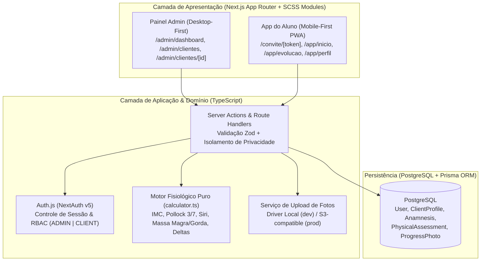

# Especificação de Design — Sub-projeto 1: Fundação, Design System SCSS & Gestão de Clientes, Anamnese e Avaliações Físicas

- **Data:** 2026-10-17
- **Projeto:** PersonalTrainer (*Joana Antunes Coaching*)
- **Escopo:** Sub-projeto 1 de 4 do MVP (Fundação + Gestão de Alunos, Convites, Anamnese/PAR-Q, Avaliação Física Pollock 3/7 & Fotos de Evolução)

---

## 1. Visão Geral e Objetivos

O produto é uma plataforma B2B2C no formato **Web App Responsivo + PWA** voltada para Personal Trainers gerenciarem seus alunos com alto padrão visual (*Joana Antunes Coaching*).

Como o MVP completo compreende 4 domínios independentes, o produto foi decomposto em 4 sub-projetos sequenciais:
1. **Sub-projeto 1 (Este documento):** Fundação (Auth, Layout Admin/Mobile, Design System em SCSS) + Gestão de Clientes, Onboarding via Link de Convite, Anamnese Clínica (PAR-Q) e Avaliações Físicas (Perimetria, Pollock 3/7 Dobras e Fotos Antes/Depois).
2. **Sub-projeto 2:** Biblioteca de Exercícios & Prescrição de Planos de Treino.
3. **Sub-projeto 3:** Execução de Treino pelo Aluno (Mobile PWA — Registro de Cargas, Séries e Cronômetro).
4. **Sub-projeto 4:** Check-in Semanal, Agenda & Acompanhamento.

---

## 2. Stack Tecnológica & Arquitetura



- **Framework:** Next.js (App Router) com TypeScript estrito.
- **Estilização:** **SCSS Puro + CSS Modules (`.module.scss`)**. Zero Tailwind CSS.
- **Banco de Dados:** PostgreSQL com Prisma ORM.
- **Autenticação:** Auth.js (Credentials Provider com hash `bcryptjs`), sessão JWT contendo `userId` e `role` (`ADMIN` | `CLIENT`).
- **Validação:** `zod` em todas as entradas de Server Actions e formulários.
- **Testes:** `vitest` e `@testing-library/react`.

---

## 3. Design System & Arquitetura SCSS (`src/styles/`)

Seguindo as regras definidas em `AGENTS.md`:

### 3.1 Estrutura de Arquivos SCSS
- `src/styles/_variables.scss`: Tokens de cores (`#141414`, `#F8F7F4`, `#FFFFFF`, `#C5A059`, `#1A1A1A`, `#757575`, `#EAE6DF`), fontes (`Cormorant Garamond` para display/monograma e `Plus Jakarta Sans` para UI), raios de borda e sombras.
- `src/styles/_mixins.scss`: Mixins reutilizáveis para cards (`@mixin card-surface`), botões (`@mixin button-gold`, `@mixin button-outline`), inputs com contraste escuro garantido (`color: #1A1A1A`) e media queries (`@mixin desktop`, `@mixin mobile`).
- `src/styles/globals.scss`: Reset CSS, definição de cores base e prevenção de inversão automática de cores em inputs pelo navegador.

### 3.2 Regras Visuais Chave
- **Contraste Garantido:** Todo card claro (`#FFFFFF` ou `#F8F7F4`) aplica obrigatoriamente fonte `#1A1A1A` para títulos/valores/inputs e `#555555`/`#757575` para rótulos. Textos brancos (`#FFFFFF`) são restritos aos containers escuros (`#141414`).
- **Layout Admin (`ADMIN`):** Sidebar esquerda fixa (`240px`, `#141414`) com monograma `JA` dourado e navegação principal; conteúdo principal em `#F8F7F4`.
- **Layout Aluno (`CLIENT`):** Container centralizado estilo mobile (`max-width: 480px`) com barra de navegação inferior fixa de 5 itens (`Início`, `Treinos`, `Evolução`, `Check-in`, `Mais`). No Sub-projeto 1, as abas `Início`, `Evolução` e `Mais/Perfil` estarão totalmente funcionais com os dados de peso, avaliação e anamnese; `Treinos` e `Check-in` exibirão estado vazio elegante preparado para os Sub-projetos 2, 3 e 4.

---

## 4. Modelo de Dados (`prisma/schema.prisma`)

```prisma
enum Role {
  ADMIN
  CLIENT
}

enum ClientStatus {
  INVITED
  ACTIVE
  INACTIVE
}

enum BiologicalSex {
  MALE
  FEMALE
}

enum ActivityLevel {
  SEDENTARY
  LIGHT
  MODERATE
  INTENSE
}

enum AssessmentProtocol {
  POLLOCK_7
  POLLOCK_3
  BIOIMPEDANCE
  MANUAL
}

enum PhotoAngle {
  FRONT
  BACK
  SIDE
}

model User {
  id             String          @id @default(cuid())
  name           String
  email          String          @unique
  passwordHash   String
  role           Role            @default(CLIENT)
  createdAt      DateTime        @default(now())
  updatedAt      DateTime        @updatedAt

  // Relacionamentos
  managedClients ClientProfile[] @relation("TrainerClients")
  clientProfile  ClientProfile?  @relation("StudentUser")
}

model ClientProfile {
  id              String               @id @default(cuid())
  trainerId       String
  trainer         User                 @relation("TrainerClients", fields: [trainerId], references: [id], onDelete: Cascade)
  userId          String?              @unique
  user            User?                @relation("StudentUser", fields: [userId], references: [id], onDelete: SetNull)

  fullName        String
  email           String
  phone           String?
  birthDate       DateTime?
  gender          BiologicalSex        @default(FEMALE)
  heightCm        Float?
  mainGoal        String?
  status          ClientStatus         @default(INVITED)

  inviteToken     String?              @unique
  inviteExpiresAt DateTime?

  createdAt       DateTime             @default(now())
  updatedAt       DateTime             @updatedAt

  anamnesis       Anamnesis?
  assessments     PhysicalAssessment[]
  progressPhotos  ProgressPhoto[]

  @@index([trainerId])
  @@unique([trainerId, email])
}

model Anamnesis {
  id                    String        @id @default(cuid())
  clientId              String        @unique
  client                ClientProfile @relation(fields: [clientId], references: [id], onDelete: Cascade)

  // Questionário PAR-Q (7 perguntas oficiais)
  parqHeartCondition    Boolean       @default(false)
  parqChestPainActivity Boolean       @default(false)
  parqChestPainRest     Boolean       @default(false)
  parqDizziness         Boolean       @default(false)
  parqBoneJointProblem  Boolean       @default(false)
  parqBloodPressureMeds Boolean       @default(false)
  parqOtherReason       Boolean       @default(false)
  hasMedicalRestriction Boolean       @default(false)

  // Histórico Clínico & Rotina
  injuriesOrPains       String?
  surgeriesHistory      String?
  medications           String?
  allergies             String?
  sleepHoursAvg         Float?
  sleepQuality          String?
  workActivityLevel     ActivityLevel @default(SEDENTARY)
  waterIntakeLiters     Float?
  notes                 String?

  completedAt           DateTime      @default(now())
  updatedAt             DateTime      @updatedAt
}

model PhysicalAssessment {
  id                   String             @id @default(cuid())
  clientId             String
  client               ClientProfile      @relation(fields: [clientId], references: [id], onDelete: Cascade)
  assessedAt           DateTime           @default(now())

  weightKg             Float
  heightCm             Float
  bmi                  Float

  protocol             AssessmentProtocol @default(POLLOCK_7)
  // Dobras Cutâneas (mm)
  chestMm              Float?
  midaxillaryMm        Float?
  tricepsMm            Float?
  subscapularMm        Float?
  abdominalMm          Float?
  suprailiacMm         Float?
  thighMm              Float?

  // Resultados de Composição Corporal
  skinfoldSumMm        Float?
  bodyDensity          Float?
  bodyFatPercentage    Float?
  fatMassKg            Float?
  leanMassKg           Float?

  // Perimetria / Circunferências (cm)
  neckCm               Float?
  shouldersCm          Float?
  chestCm              Float?
  waistCm              Float?
  abdomenCm            Float?
  hipCm                Float?
  armRelaxedRightCm    Float?
  armRelaxedLeftCm     Float?
  armContractedRightCm Float?
  armContractedLeftCm  Float?
  forearmRightCm       Float?
  forearmLeftCm        Float?
  thighRightCm         Float?
  thighLeftCm          Float?
  calfRightCm          Float?
  calfLeftCm           Float?

  notes                String?
  photos               ProgressPhoto[]

  @@index([clientId, assessedAt])
}

model ProgressPhoto {
  id           String              @id @default(cuid())
  clientId     String
  client       ClientProfile       @relation(fields: [clientId], references: [id], onDelete: Cascade)
  assessmentId String?
  assessment   PhysicalAssessment? @relation(fields: [assessmentId], references: [id], onDelete: SetNull)

  angle        PhotoAngle
  imageUrl     String
  takenAt      DateTime            @default(now())

  @@index([clientId, takenAt])
}
```

---

## 5. Motor de Cálculos Fisiológicos (`src/domain/assessment/calculator.ts`)

Módulo puro e determinístico responsável por todos os cálculos antropométricos:

1. **Cálculo de IMC (`calculateBmi`):**
   - Fórmula: $\text{IMC} = \frac{\text{pesoKg}}{(\text{alturaCm} / 100)^2}$ (arredondado em 2 casas decimais).
2. **Protocolo Jackson & Pollock 7 Dobras (`calculatePollock7`):**
   - Soma $S_7 = \text{peitoral} + \text{axilarMédia} + \text{tríceps} + \text{subescapular} + \text{abdominal} + \text{supraIlíaca} + \text{coxa}$.
   - **Homens:** $D = 1.112 - 0.00043499(S_7) + 0.00000055(S_7)^2 - 0.00028826(\text{idade})$.
   - **Mulheres:** $D = 1.097 - 0.00046971(S_7) + 0.00000056(S_7)^2 - 0.00012828(\text{idade})$.
3. **Protocolo Jackson & Pollock 3 Dobras (`calculatePollock3`):**
   - **Homens** ($\text{peitoral} + \text{abdominal} + \text{coxa}$): $D = 1.10938 - 0.0008267(S_3) + 0.0000016(S_3)^2 - 0.0002574(\text{idade})$.
   - **Mulheres** ($\text{tríceps} + \text{supraIlíaca} + \text{coxa}$): $D = 1.0994921 - 0.0009929(S_3) + 0.0000023(S_3)^2 - 0.0001392(\text{idade})$.
4. **Equação de Siri (`calculateSiriBodyFat`):**
   - $\%G = \left(\frac{495}{D}\right) - 450$.
   - $\text{Massa Gorda (kg)} = \text{pesoKg} \times (\frac{\%G}{100})$.
   - $\text{Massa Magra (kg)} = \text{pesoKg} - \text{Massa Gorda (kg)}$.
5. **Comparador de Evolução (`calculateAssessmentDelta`):**
   - Compara a avaliação atual com a imediatamente anterior e com a avaliação inicial, retornando variações de peso ($\Delta \text{ kg}$), percentual de gordura ($\Delta \%$) e massa magra ($\Delta \text{ kg}$).
6. **Avaliador de Alerta PAR-Q (`evaluateParqRestriction`):**
   - Retorna `hasMedicalRestriction = true` caso qualquer uma das 7 respostas do PAR-Q seja `true`.

---

## 6. Fluxos Funcionais e Telas

### 6.1 Fluxo de Convite & Onboarding do Aluno (`/convite/[token]`)
1. A Personal acessa `/admin/clientes` e clica em **"+ Novo Cliente"**.
2. Preenche Nome, Email, Telefone, Sexo Biológico, Data de Nascimento, Altura e Objetivo Inicial.
3. O sistema cria `ClientProfile` com `status = INVITED`, gera `inviteToken` criptográfico (`crypto.randomBytes(24).toString('hex')`) válido por 7 dias e exibe o link pronto para copiar/enviar no WhatsApp (além de permitir que a própria Personal preencha a anamnese presencialmente se desejar).
4. O Aluno abre `/convite/[token]` no celular:
   - **Passo 1:** Tela de Boas-Vindas escura (`#141414`) com monograma `JA` dourado; define sua senha de acesso.
   - **Passo 2:** Preenche objetivos, rotina de sono, hidratação, histórico de lesões/medicamentos e o questionário PAR-Q.
   - **Passo 3:** Faz upload opcional das 3 fotos iniciais (`Frente`, `Costas`, `Perfil`) e informa peso inicial.
5. Ao concluir: cria o registro `User` (`role = CLIENT`), vincula ao `ClientProfile`, salva `Anamnesis`, limpa `inviteToken`, muda `status = ACTIVE` e autentica o aluno rumo a `/app/inicio`.

### 6.2 Painel da Personal Trainer (`/admin/*`)
- **`/admin/dashboard`:** Cards de KPIs no topo (*Clientes Ativos*, *Anamneses Pendentes*, *Avaliações Realizadas*) + listas rápidas de últimos clientes avaliados e alertas PAR-Q.
- **`/admin/clientes`:** Listagem de clientes com busca instantânea por nome/email, filtro por status (`Todos`, `Ativos`, `Convidados`), botão de copiar link de convite e botão **"+ Novo Cliente"**.
- **`/admin/clientes/[id]` (Perfil 360º do Cliente):**
  - Banner superior de alerta caso `anamnesis.hasMedicalRestriction == true`.
  - **Aba Resumo:** Cards de Dados Pessoais, Estatísticas de Evolução ($\Delta$ de Peso, Massa Magra e % Gordura), Gráfico SVG de Linha Dourada com histórico de peso, card da Última Avaliação Física, miniatura das 3 últimas fotos e resumo da Perimetria.
  - **Aba Avaliações:** Formulário interativo com cálculo em tempo real (Pollock 7, Pollock 3 ou Bioimpedância/Manual + Perimetria completa) e tabela de histórico comparativo entre avaliações.
  - **Aba Anamnese:** Visualização e edição completa do questionário clínico e PAR-Q.
  - **Aba Progresso (Fotos):** Galeria e comparador lado a lado (*Antes vs. Atual*) filtrável por ângulo (`Frente`, `Costas`, `Perfil`).

### 6.3 Área Mobile PWA do Aluno (`/app/*`)
- **`/app/inicio`:** Saudação personalizada ("Olá, João 👋"), Card de Objetivo, KPIs de *Peso Atual* e *Desde o início* ($\Delta \text{ kg}$) e barra de navegação inferior.
- **`/app/evolucao`:** Seletor de métrica (`Peso (kg)`, `% Massa Gorda`, `Massa Magra`), filtro de período (`1M`, `3M`, `6M`, `1A`, `Tudo`), gráfico de linha dourada e cards de marcos alcançados.
- **`/app/perfil`:** Foto/avatar, acesso aos seus Dados Pessoais, Objetivo, Medicação/Alergias (Anamnese) e suas Fotos de Progresso.

---

## 7. Segurança, Upload de Fotos & Tratamento de Erros

- **Isolamento Multi-Tenant ("Privacidade Total"):**
  - Nenhuma Server Action aceita `trainerId` vindo do cliente; `trainerId` é sempre extraído da sessão autenticada (`session.user.id`).
  - Rotas de leitura de fotos (`/api/photos/[photoId]`) verificam se o usuário logado é o `trainerId` dono do cliente ou o próprio `userId` do cliente.
- **Validação & Casos de Borda:**
  - Token de convite inválido ou expirado renderiza tela dedicada informando que o convite expirou ou já foi ativado, com link para `/login`.
  - Schemas Zod validam limites fisiológicos seguros: peso (`20 kg` a `300 kg`), altura (`100 cm` a `250 cm`), dobras cutâneas (`1 mm` a `80 mm`), circunferências (`10 cm` a `200 cm`).
  - Upload de fotos valida MIME type (`image/jpeg`, `image/png`, `image/webp`) e tamanho máximo (`5 MB`).

---

## 8. Estratégia de Testes (TDD)

1. **Testes Unitários de Domínio (`tests/unit/calculator.test.ts`):**
   - Cálculo exato de IMC, Densidade Corporal (Pollock 7 e Pollock 3 para homens e mulheres), `% de Gordura` (Siri), Massa Magra/Gorda, Deltas entre avaliações e flag de restrição médica do PAR-Q.
2. **Testes de Validação & Regras de Convite (`tests/unit/schemas.test.ts`):**
   - Validação Zod de limites fisiológicos, expiração de token de convite e bloqueio de convite já ativado.
3. **Testes de Integração de Fluxo (`tests/integration/client-onboarding.test.ts`):**
   - Criação de cliente pela Personal -> ativação pelo token de convite -> criação de Anamnese -> criação de Avaliação Física -> verificação de isolamento de privacidade entre diferentes Personais/Clientes.
4. **Verificação Visual (`browser-testing`):**
   - Inspecionar `/login`, `/admin/dashboard`, `/admin/clientes/[id]`, `/convite/[token]` e `/app/inicio` garantindo fidelidade ao mockup e contraste escuro legível em todos os campos claros.
